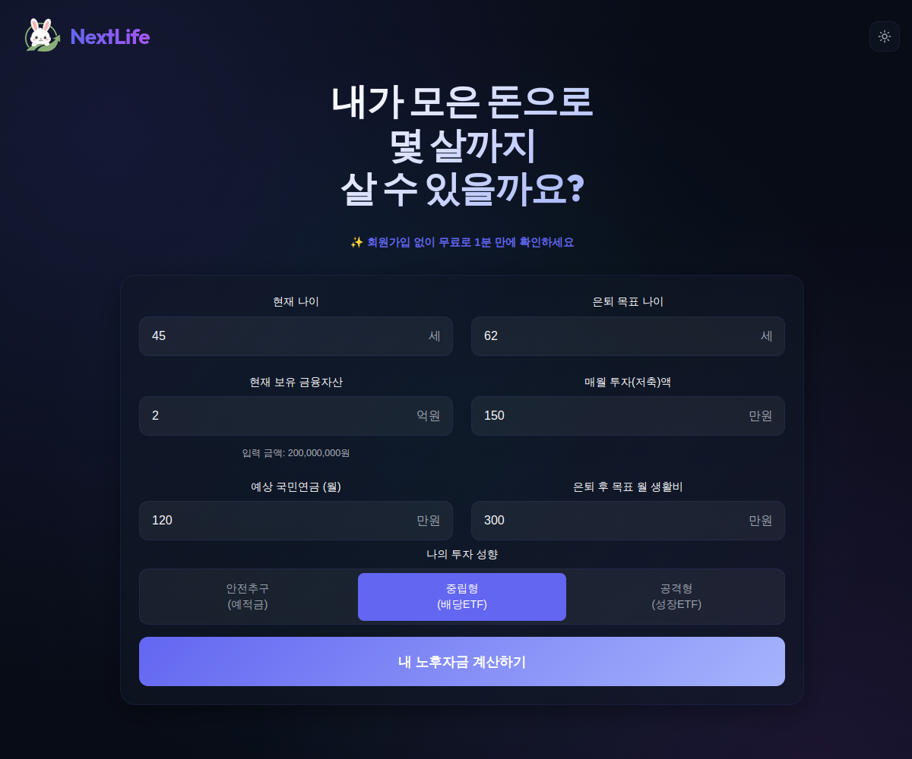

# NextLife 은퇴 설계 시뮬레이터

**[데모 사이트 열기 →](https://next.tokkilab.com)**



NextLife는 현재 자산과 투자 현황을 바탕으로 은퇴 목표를 최대 5개까지 선택하고, 여러 은퇴
전략을 자동으로 비교해 **안정형·균형형·여유형** 대안을 추천하는 목표 기반 은퇴 설계
서비스입니다. 월 단위 엔진이 국민연금·사적연금·ISA·일반 투자자산·세금·건강보험료를 함께
계산하며, 결정론적 분석 뒤 3,000회 Monte Carlo 검증으로 불확실성도 보여 줍니다.

현재 사용자 흐름은 다음과 같습니다.

```text
개인정보(현재 나이·기대수명)
        ↓
현재 자산·연금·기타소득 입력
        ↓
은퇴 목표 1~5개 선택 및 우선순위 설정
        ↓
현재 계획 분석
        ↓
전략 후보 자동 생성·목표 달성도 평가
        ↓
Monte Carlo 검증
        ↓
안정형·균형형·여유형 추천
```

주요 특징:

- **목표 기반 입력** — 생활비 안정, 빠른 은퇴, 자산 고갈 방지, 여유 있는 소비, 주거 안정,
  연금 활용, 절세, 위험 감소, 상속, 자산 성장 중 최대 5개를 선택합니다.
- **자동 전략 탐색** — 은퇴 나이, 국민연금 개시 나이, 계좌 인출 순서, 소비 패턴을 조합하고
  현재 계획을 기준 후보로 함께 평가합니다.
- **목표 제약과 확률 검증** — HARD/SOFT 목표를 구분해 후보를 걸러 내고, 최종 후보는 고정
  시드의 Monte Carlo 3,000회로 다시 검증합니다. 표시되는 확률에는 시행 수와 95%
  신뢰구간을 함께 밝힙니다.
- **월 단위 금융 계산** — 복리, 적립, 인출, 세금, 건강보험료와 가중평균 원가 기반 실현손익을
  하나의 원장 흐름으로 계산합니다.
- **명확한 배당 의미** — `totalReturn`은 배당을 포함한 총수익률입니다. 일반계좌의 배당은
  재투자를 끈 경우에만 생활비에 쓸 수 있는 현금 배당소득이며, 재투자 배당은 자산에 남아
  현금소득과 별도로 표시됩니다.
- **ETF별 수익률 입력** — 각 ETF에 기존 공통 수익률 가정을 채우거나 과거 자료 추정값을
  조회할 수 있습니다. 수정 종가를 이용한 과거 연환산 수익률도 기간과 함께 확인해 직접 적용할
  수 있습니다. ETF별 자동 반영을 켜면 시나리오를 열 때 다시 조회합니다. 과거 수익률은 미래
  수익률을 보장하지 않으며 자료가 누락되거나 오래되면 기존 값을 유지합니다.
- **기준을 밝히는 결과 화면** — 결과는 `현재 계획 진단` → `NextLife 추천` → `실행 시점` →
  `계획의 근거` 순으로 읽습니다. 성공률·지속 가능한 한도·민감도처럼 서로 다른 실행에서 나온
  값은 그 기준을 문장으로 함께 표시하며, 그 문구는 core에 한 벌만 두어 화면과 PDF가 같은
  문장을 인쇄합니다.
- **브라우저 내 계산과 E2EE** — 시나리오는 보안키로 브라우저에서 암호화되며 서버는 평문을
  알 수 없습니다. 계산과 추천 역시 브라우저 및 Web Worker에서 실행됩니다.
- **투자 비교 기준 보관** — 현재 계획을 시나리오 안에 별도 저장할 수 있습니다. 실제 수량
  자동 갱신과 저장된 기준을 이용한 진행 상황 비교는 아직 제공하지 않습니다.
- **기준 수량 시세 참고** — 저장한 기준 계획의 ETF 수량에 조회 시세를 곱해 보여 줍니다.
  같은 ETF의 현재 입력 수량도 같은 시세로 평가해 수량 차이에 따른 참고값을 비교합니다.
  적립·매매·배당·분할은 반영하지 않으며 실제 잔고가 아닙니다. 사용자가 선택하면 같은
  ETF의 조회 시세를 현재 계획에 반영하고 현재 입력에 대한 분석이 있으면 다시 실행합니다. 수량은 바뀌지 않습니다.
- **선택적 ETF 시세 자동 반영** — 사용자가 설정을 켜면 시나리오를 열 때 현재 계획에 있는
  ETF의 시세를 반영합니다. 수량·배당·분할은 갱신하지 않습니다.
- **출생연도 선택 입력** — 입력하면 시나리오를 다시 열 때 현재 연도에서 출생연도를 뺀
  나이를 사용합니다. 생일을 반영한 만 나이는 아니며, 미입력 시 기존 나이를 유지합니다.

계정은 이메일로 받은 6자리 보안키로 로그인하며 같은 키로 자산 데이터를 암호화합니다. 기존
이메일의 보안키를 초기화한 뒤 새 키로 로그인하면 이전 암호화 데이터는 복구할 수 없고 기존
시나리오가 삭제됩니다. 사용자당 시나리오는 최대 5개까지 만들 수 있습니다.

---

## 시작하기

```bash
npm ci
npm run dev          # prisma db push 후 next dev
```

`http://localhost:3000`에서 열립니다. 3000번 포트가 사용 중이라면
`npm run dev -- -p 3001`처럼 포트를 지정할 수 있습니다.

운영 환경에서는 `NEXTAUTH_SECRET`에 `openssl rand -base64 32`로 만든 고유한 값을 설정하세요.
`.env.example`의 빈 값이나 개발용 값을 재사용하지 마세요.

### 로그인 없이 개발 모드 실행

```bash
npm run dev
```

개발 서버에서는 로그인·회원가입을 건너뛰고 `/simulator`를 바로 사용할 수 있습니다. `NODE_ENV=development`에서
자동 활성화되며, 서버 API도 동일한 개발 세션을 사용합니다. 개발용 Docker Compose는 아래처럼
실행합니다.

```bash
cp .env.example .env
docker compose up --build
```

개발용 Docker 데이터는 `./data-dev`에 저장됩니다. `NODE_ENV=production`에서는 개발 모드가 항상
비활성화됩니다. 다른 비프로덕션 환경에서만 명시적으로 켜려면 `NEXT_PUBLIC_DEV_MODE=true`를 설정하세요
(`src/core/utils/isDevMode.ts`).

---

## 환경 변수

`.env.example`을 `.env`로 복사한 뒤 필요한 값을 설정합니다.

| 변수 | 용도 |
|---|---|
| `DATABASE_URL` | Prisma 연결 문자열(기본 SQLite) |
| `NEXTAUTH_SECRET` / `NEXTAUTH_URL` | next-auth 세션 |
| `GOOGLE_SITE_VERIFICATION` | Google 사이트 소유권 확인(선택) |
| `DEV_NEXTAUTH_URL` | 개발 콜백 origin 강제 지정(선택) |
| `NEXT_PUBLIC_DEV_MODE` | development 외 비프로덕션 환경에서 개발 모드 사용(선택) |
| `NEXT_PUBLIC_APP_URL` | 메일 링크 등에 사용하는 공개 URL |
| `SMTP_HOST` / `SMTP_PORT` / `SMTP_USER` / `SMTP_PASSWORD` / `EMAIL_FROM` | 이메일 가입·보안키 발송 |
| `OLLAMA_ENDPOINT` / `OLLAMA_MODEL` | 분석 조언 문구 생성(미설정·실패 시 규칙 기반 폴백) |
| `ADMIN_KEY` | 관리자 API 접근 |

LLM은 선택적인 설명 문구에만 사용합니다. 계산, 목표 점수, 후보 순위, 추천 결과는 결정론적
코드가 담당합니다.

Docker 시작 스크립트는 SQLite에 `prisma db push --accept-data-loss`를 적용합니다. 배포 전
데이터베이스를 백업하고 스키마 변경으로 데이터가 손실되지 않는지 확인하세요. 기존 계정 데이터를
초기화하는 작업은 기본적으로 실행하지 않습니다. 의도적으로 초기화할 때만
`RESET_LEGACY_ACCOUNT_DATA=true`를 설정하세요. 이 옵션은 사용자·인증 토큰·사용자 종속 데이터를
지우고 `AnalyticsEvent`는 보존합니다.

---

## 스크립트

```bash
npm run dev          # 개발 서버(prisma db push 포함)
npm run build        # 프로덕션 빌드(prisma generate 포함)
npm start            # 프로덕션 실행
npm test             # vitest 전체 실행
npm run test:watch   # vitest watch
npm run lint         # eslint
```

---

## 프로젝트 구조

`src/core/`는 React·Next.js·DB에 의존하지 않는 순수 TypeScript 도메인입니다. 화면과 Web
Worker는 같은 엔진·평가·추천 코드를 사용합니다.

```text
src/
├── core/
│   ├── entities/            # 시뮬레이션·목표·전략 도메인 모델
│   ├── domain/input/        # 입력 정규화·검증
│   ├── evaluation/          # 목표 달성도와 HARD/SOFT 평가
│   ├── strategy/            # 후보 생성·최적화
│   ├── recommendation/      # 안정형·균형형·여유형 선정
│   └── usecases/
│       ├── SimulationEngine.ts
│       ├── tax/             # 중앙 세법 프로필과 세금 계산
│       ├── montecarlo/      # 확률 경로·순서 리스크
│       ├── healthcare/      # 의료비·건강보험료 추정
│       └── dashboard/       # 화면·PDF 공용 파생 지표
├── app/                     # Next.js App Router와 API
├── web/                     # 화면, 훅, Web Worker, 공용 UI
├── infrastructure/          # DB·스토리지 어댑터
└── tests/                   # core/app/web 구조를 반영한 Vitest 테스트
```

### 분석 파이프라인

```text
사용자 사실 입력 + 목표 1~5개
  → 기존 데이터 정규화·어댑터
  → 현재 계획 결정론적 시뮬레이션
  → 전략 후보 생성
  → HARD 사전 검증
  → 결정론적 시뮬레이션·목표 평가·순위화
  → 상위 후보 Monte Carlo 검증
  → 안정형·균형형·여유형 추천
```

현재 후보 생성 축은 은퇴 나이, 국민연금 개시 나이, 계좌 인출 정책, 소비 패턴입니다. 사적연금
개시 나이, 현금 버퍼, 동적 가드레일, `max_sustainable` 소비 모드는 아직 자동 탐색 축이
아닙니다. 자세한 제품 계약과 제한사항은 [PRD](docs/PRD.md)를 참고하세요.

---

## 테스트

```bash
npm test
```

GitHub Actions는 pull request와 `main`·`develop` 푸시에서 린트, 전체 테스트, 프로덕션 빌드를
실행합니다. 로컬에서도 `npm run lint`, `npm test`, `npm run build`로 확인할 수 있습니다.

> `.worktrees/` 아래 별도 설치가 메인 테스트의 모듈 탐색 범위에 들어가면 React가 중복 로드될
> 수 있습니다. 워크트리별 의존성과 실행 위치를 확인하세요.

---

## 기술 스택

Next.js 16.2.7(App Router) · React 19.2.4 · TypeScript(strict) · Prisma 6.19.3 + SQLite ·
next-auth · Recharts 3.8.1 · jsPDF 4.2.1 + html2canvas · Vitest 4.1.8

---

## 문서

- [사용자 매뉴얼 — 초보자·중급자·고급자](docs/user-manual.md)
- [제품 요구사항](docs/PRD.md)
- [에이전트 작업 지침](AGENTS.md)
- `docs/releases/` — 릴리스별 변경 내역과 배경
- [기여 안내](CONTRIBUTING.md)
- [보안 정책과 위협 모델](SECURITY.md)

설계 판단은 주변 주석과 회귀 테스트에 함께 남깁니다. 특히 `SimulationEngine.ts`, 세금 엔진,
정규화·마이그레이션 코드는 단순해 보이는 분기라도 기존 데이터와 회계 불변식을 보호할 수 있으므로
수정 전에 호출 경로와 주석을 확인해야 합니다.

## 금융 정보 안내

NextLife는 계획을 비교하기 위한 시뮬레이터이며 투자·세무·법률 자문이 아닙니다. 결과는 입력값과
가정에 따라 달라지며 실제 수익이나 은퇴 시점을 보장하지 않습니다.

## 라이선스

프로젝트 코드는 [MIT License](LICENSE)로 배포합니다. 저장소에 포함되거나 사용되는 외부
라이브러리와 자료는 각각의 라이선스를 따릅니다.
